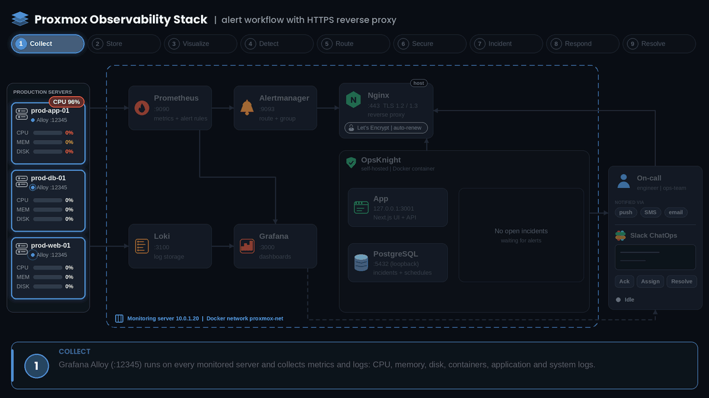
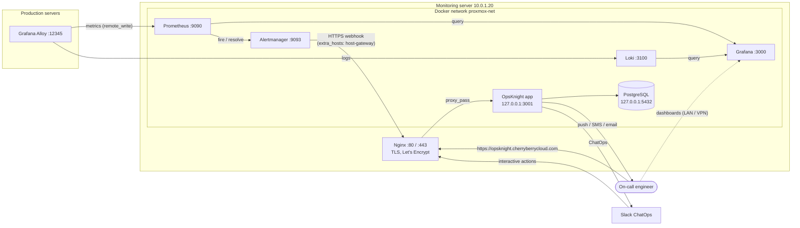
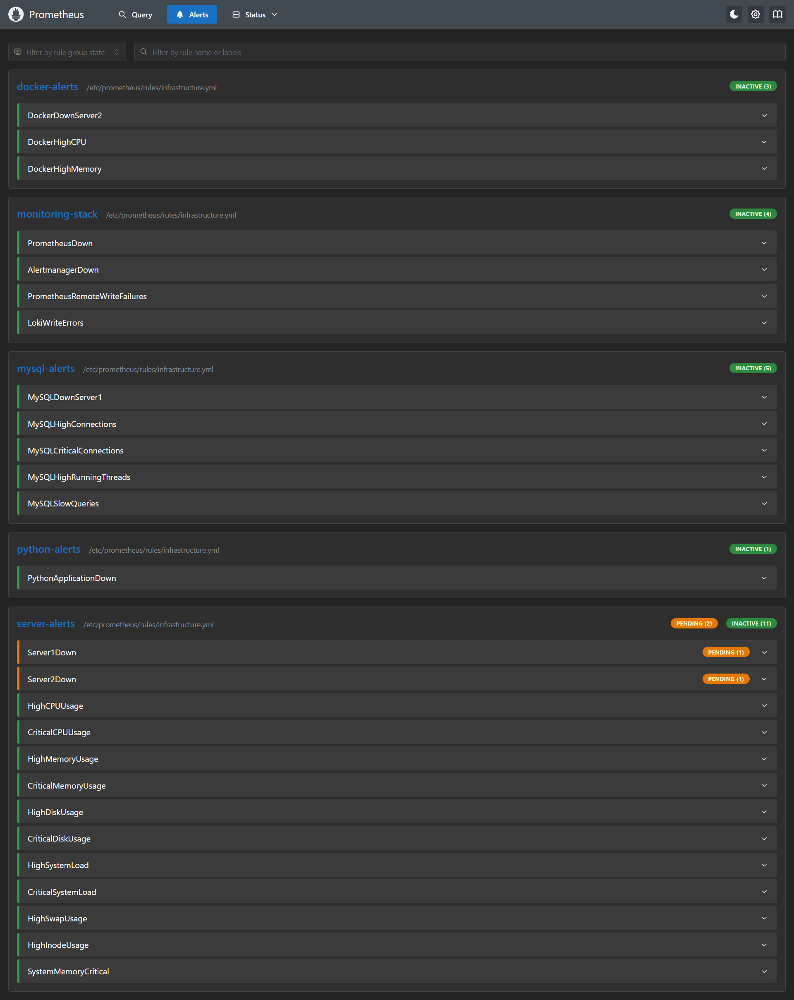
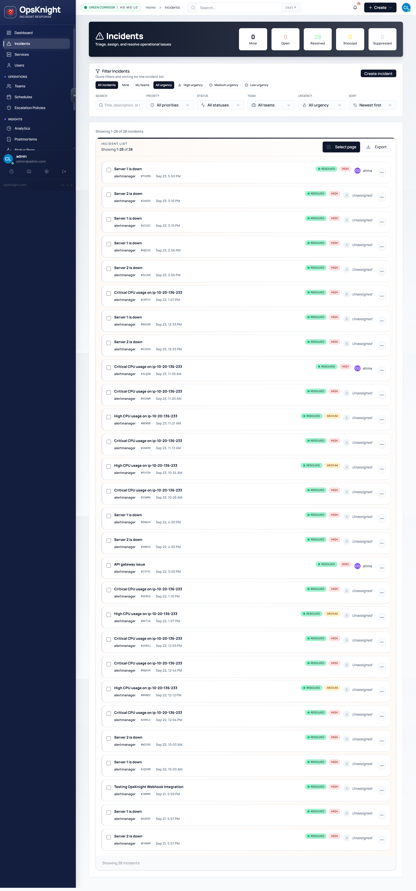
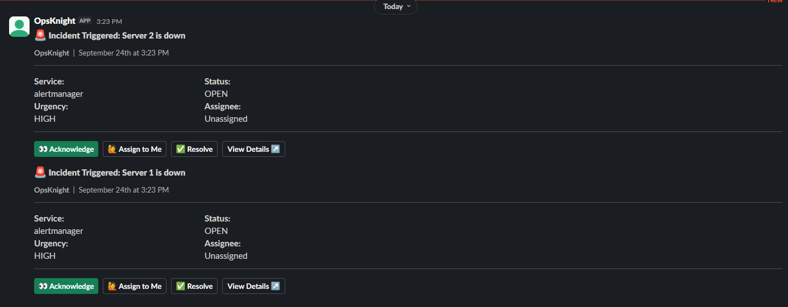

# Proxmox Production Monitoring System

[](https://github.com/Ahmadraza9091/proxmox-observability-stack)
[](LICENSE)
[](https://www.linux.org)
[](https://www.docker.com)
[](#reverse-proxy-tls--domain)

A centralized monitoring and alerting platform for Proxmox / on-premises servers. **Grafana Alloy** collects metrics and logs, **Prometheus**, **Loki** and **Grafana** store and visualize them, **Alertmanager** routes alerts, and a **self-hosted OpsKnight** container turns them into managed incidents. OpsKnight is published only through an **Nginx reverse proxy with TLS on your own domain**. No cloud or SaaS dependency for incident data.



[Architecture](#architecture) • [Workflow](#workflow) • [Deployment](#deployment) • [Reverse proxy, TLS & domain](#reverse-proxy-tls--domain) • [Configuration](#configuration) • [Troubleshooting](#troubleshooting) • [Security](#security)

---

## Contents

1. [Features](#features)
2. [Architecture](#architecture)
3. [Components](#components)
4. [Workflow](#workflow)
5. [Deployment](#deployment)
6. [Reverse proxy, TLS & domain](#reverse-proxy-tls--domain)
7. [Configuration](#configuration)
8. [Dashboards & queries](#dashboards--queries)
9. [Incident management (OpsKnight)](#incident-management-opsknight)
10. [Troubleshooting](#troubleshooting)
11. [Security](#security)
12. [Repository structure](#repository-structure)
13. [Quick reference](#quick-reference)
14. [Production checklist](#production-checklist)
15. [For new engineers](#for-new-engineers)

---

## Features

| Feature | Description |
|---|---|
| **Real-time monitoring** | Metrics, logs and system telemetry from every server via Grafana Alloy |
| **Dashboards** | Grafana dashboards for servers, containers, MySQL, applications and logs |
| **Rule-based alerting** | Prometheus rules with thresholds, `for:` durations and severity routing |
| **Managed incidents** | OpsKnight: acknowledge, assign, snooze, escalate, resolve, with on-call schedules |
| **Slack ChatOps** | Incident war room with one-click actions, posted by OpsKnight's own Slack app |
| **HTTPS by default** | Nginx terminates TLS (Let's Encrypt) on your domain; the app only listens on loopback |
| **Private by design** | Prometheus, Grafana, Loki and Alertmanager are bound to the private IP, never public |
| **Infrastructure as code** | Docker Compose for the stack, Ansible for Alloy on monitored servers |

> Incident handling was previously a custom Flask "Alert Action Service". It has been removed and replaced by [OpsKnight](https://github.com/opsknight-labs/OpsKnight) (Apache-2.0), which owns notifications, on-call, escalation and resolution tracking in its own PostgreSQL.

---

## Architecture



More diagrams (data flow, ERD, use cases): [`docs/diagrams.md`](docs/diagrams.md).

### Network exposure

| Service | Bound to | Reachable from |
|---|---|---|
| Nginx | `0.0.0.0:80`, `0.0.0.0:443` | Internet (or your LAN). The only public entry point |
| OpsKnight app | `127.0.0.1:3001` → container `3000` | The host only, via Nginx |
| OpsKnight PostgreSQL | `127.0.0.1:5432` | The host only (and the `proxmox-net` network) |
| Prometheus / Alertmanager / Loki / Grafana | `10.0.1.20:9090 / 9093 / 3100 / 3000` | Private LAN or VPN only |
| Grafana Alloy | `:12345` on each monitored server | Local to the server |

> Docker publishes ports through its own iptables rules and **bypasses `ufw`**. Binding each service to a specific IP in `docker-compose.yml` is what keeps it private, so keep those bindings.

---

## Components

| Component | Image / version | Purpose | Runs on |
|---|---|---|---|
| **Grafana Alloy** | installed by Ansible | Collects metrics and logs | Monitored servers |
| **Prometheus** | `prom/prometheus:v3.13.2` | Stores metrics, evaluates alert rules, accepts remote_write | Monitoring server |
| **Loki** | `grafana/loki:3.5.0` | Log storage | Monitoring server |
| **Grafana** | `grafana/grafana:11.2.0` | Dashboards | Monitoring server |
| **Alertmanager** | `prom/alertmanager:v0.28.1` | Groups, routes, resolves alerts | Monitoring server |
| **OpsKnight app** | `ghcr.io/opsknight-labs/opsknight:2.0.0` | Incidents, on-call, escalation, Slack ChatOps | Monitoring server (container) |
| **OpsKnight DB** | `postgres:15-alpine` | Incidents, schedules, users, encrypted credentials | Monitoring server (container) |
| **Nginx** | system package | Reverse proxy, TLS termination, HTTP → HTTPS redirect | Monitoring server (host) |
| **Certbot** | system package | Issues and renews the Let's Encrypt certificate | Monitoring server (host) |
| **Slack** | SaaS | ChatOps messages and actions only, no incident data stored | Cloud |
| **Ansible** | 2.9+ | Installs and configures Alloy | Admin machine |

---

## Workflow

| # | Stage | What happens |
|---|---|---|
| 1 | **Collect** | Alloy on each server gathers CPU, memory, disk, container, application metrics and system logs |
| 2 | **Store** | Metrics go to Prometheus (`remote_write`), logs to Loki, both on `10.0.1.20` |
| 3 | **Visualize** | Grafana queries both for dashboards and drill-down |
| 4 | **Detect** | Prometheus evaluates rules every 30s: `CPU > 90%` for 5m → **FIRING**, severity `critical` |
| 5 | **Route** | Alertmanager groups by severity and POSTs the webhook to `https://opsknight.cherryberrycloud.com/api/integrations/prometheus` |
| 6 | **Secure** | Nginx terminates TLS (Let's Encrypt) and proxies to `127.0.0.1:3001` |
| 7 | **Incident** | OpsKnight de-duplicates (Alertmanager `fingerprint`), creates the incident, stores it in PostgreSQL |
| 8 | **Respond** | On-call is notified by push, SMS, email and Slack, then acknowledges, assigns or escalates via the same HTTPS URL |
| 9 | **Resolve** | Alert clears, Alertmanager sends `RESOLVED` (`send_resolved: true`), OpsKnight auto-closes the incident |

How OpsKnight builds the incident: the title comes from `annotations.summary` → `annotations.description` → `labels.alertname` → `"Prometheus Alert"`. The `severity` label maps `critical`/`page` → critical, `error` → error, `warning` → warning (default: warning). Use lowercase values.

---

## Deployment

### Prerequisites

- Monitoring server: Ubuntu/Debian 20.04+, **6 GB+ RAM**, 50 GB+ disk, a private IP (examples use `10.0.1.20`)
- Monitored servers: Linux (Ubuntu / Debian / CentOS / RHEL)
- Docker with the Compose plugin, Nginx, Certbot, `openssl`, Ansible 2.9+
- **A domain name** (examples use `opsknight.cherryberrycloud.com`) and the ability to create a DNS record for it
- Ports **80 and 443** reachable from the internet for the certificate challenge (or use DNS-01, see [TLS options](#tls-options))

### Steps

```bash
# 1. Get the code
sudo git clone https://github.com/Ahmadraza9091/proxmox-observability-stack.git /opt/proxmox-monitoring
cd /opt/proxmox-monitoring

# 2. Create .env (see "Environment variables")
cp .env.example .env
printf 'NEXTAUTH_SECRET=%s\n' "$(openssl rand -base64 32)" >> .env
printf 'ENCRYPTION_KEY=%s\n'  "$(openssl rand -hex 32)"    >> .env
printf 'API_KEY_SECRET=%s\n'  "$(openssl rand -hex 32)"    >> .env
chmod 600 .env
$EDITOR .env      # set passwords, POSTGRES_*, OPSKNIGHT_PUBLIC_URL=https://<your-domain>

# 3. DNS: create an A record  opsknight.cherryberrycloud.com -> <server public IP>

# 4. Start the stack
docker compose up -d
docker compose ps                      # all services should be Up / healthy
curl -s http://127.0.0.1:3001/api/health?mode=readiness
```

5. **Set up Nginx and TLS**: follow [Reverse proxy, TLS & domain](#reverse-proxy-tls--domain).
6. **First login**: open `https://opsknight.cherryberrycloud.com`, create the admin account, then **Service → Integrations → Add Integration → Prometheus** and copy the **Integration ID** and **Key**.
7. **Alertmanager**: put the HTTPS webhook URL with that ID/key in `alertmanager/alertmanager.yml` ([example](#alertmanager-routing)), then `docker compose restart alertmanager`.
8. **OpsKnight setup**: create the on-call schedule, escalation policy and notification channels (email / SMS / push / Slack) and attach them to the service.
9. **Alloy on servers**: add hosts to the Ansible inventory and run the playbook ([Ansible](#ansible-alloy)).
10. **Verify** with a [test alert](#send-a-test-alert) and a real fire → ack → resolve cycle (`stress-ng --cpu 0 --timeout 5m`).

> `docker compose` (v2) is used throughout. If you only have the old binary, replace it with `docker-compose`.

---

## Reverse proxy, TLS & domain

OpsKnight's container is published on **loopback only** (`127.0.0.1:3001`) and `NEXTAUTH_URL` must be a public HTTPS URL, so a reverse proxy on the host is required. It terminates TLS, redirects HTTP → HTTPS and forwards to the container. Engineers, Slack and Alertmanager all use the same URL.

### 1. DNS and firewall

```bash
# DNS: A record  opsknight.cherryberrycloud.com  ->  <server public IP>
dig +short opsknight.cherryberrycloud.com

sudo ufw allow 80,443/tcp        # only the proxy ports; 9090/9093/3100/3000 stay private
```

### 2. Install Nginx and Certbot, issue the certificate

```bash
sudo apt update && sudo apt install -y nginx certbot

# Issue the certificate first (nginx must not be holding port 80 yet).
# The hooks stop/start nginx around issuance and every renewal (a few seconds).
sudo systemctl stop nginx
sudo certbot certonly --standalone -d opsknight.cherryberrycloud.com \
  --pre-hook "systemctl stop nginx" --post-hook "systemctl start nginx"
```

### 3. Enable the proxy

```bash
sudo cp nginx/opsknight.conf /etc/nginx/sites-available/opsknight.conf   # edit the domain if different
sudo ln -s /etc/nginx/sites-available/opsknight.conf /etc/nginx/sites-enabled/
sudo rm -f /etc/nginx/sites-enabled/default
sudo nginx -t && sudo systemctl enable --now nginx && sudo systemctl reload nginx
```

[`nginx/opsknight.conf`](nginx/opsknight.conf) in short:

```nginx
server { listen 80;  server_name opsknight.cherryberrycloud.com; return 301 https://$host$request_uri; }

server {
    listen 443 ssl;
    server_name opsknight.cherryberrycloud.com;

    ssl_certificate     /etc/letsencrypt/live/opsknight.cherryberrycloud.com/fullchain.pem;
    ssl_certificate_key /etc/letsencrypt/live/opsknight.cherryberrycloud.com/privkey.pem;
    ssl_protocols       TLSv1.2 TLSv1.3;

    location / {
        proxy_pass         http://127.0.0.1:3001;
        proxy_set_header   Host              $host;
        proxy_set_header   X-Forwarded-For   $proxy_add_x_forwarded_for;
        proxy_set_header   X-Forwarded-Proto $scheme;
    }
}
```

### 4. Match OpsKnight to the proxy (`.env`)

```bash
OPSKNIGHT_PUBLIC_URL=https://opsknight.cherryberrycloud.com   # used for NEXTAUTH_URL and NEXT_PUBLIC_APP_URL
TRUST_PROXY_HEADERS=true      # default: trust X-Forwarded-* from the proxy
TRUSTED_PROXY_HOPS=1          # Nginx = 1 hop. Use 2 if something else (e.g. Cloudflare) sits in front
```

```bash
docker compose up -d opsknight-app      # apply .env changes
```

### 5. How Alertmanager reaches the proxy

`docker-compose.yml` gives the Alertmanager container two things:

```yaml
extra_hosts:
  - "opsknight.cherryberrycloud.com:host-gateway"          # the domain resolves to the Docker host
volumes:
  - /etc/ssl/certs/ca-certificates.crt:/etc/ssl/certs/ca-certificates.crt:ro   # trusts the certificate's CA
```

The webhook therefore goes **Alertmanager → Docker host :443 → Nginx → `127.0.0.1:3001`**. It never leaves the machine, the certificate still matches the hostname, and certificate validation stays on.

### 6. Verify

```bash
# Certificate and redirect
curl -sI http://opsknight.cherryberrycloud.com  | head -n1           # 301
curl -sI https://opsknight.cherryberrycloud.com | head -n1           # 200 / 307
echo | openssl s_client -connect opsknight.cherryberrycloud.com:443 \
  -servername opsknight.cherryberrycloud.com 2>/dev/null | openssl x509 -noout -issuer -dates

# Same path Alertmanager uses (inside its container)
docker exec alertmanager wget -qO- "https://opsknight.cherryberrycloud.com/api/health?mode=readiness"

# Renewal
sudo certbot renew --dry-run
systemctl list-timers | grep certbot
```

### TLS options

| Situation | Use |
|---|---|
| Server reachable on 80/443 from the internet | HTTP-01 as above (`--standalone`, or `--webroot` to avoid the brief nginx stop) |
| Server only on a private network, internal DNS | DNS-01 with a Certbot DNS plugin (no inbound port 80 needed) or your internal CA. Mount that CA into Alertmanager |
| Another proxy (Caddy, Traefik, cloud load balancer) | Keep the same contract: HTTPS on your domain → `127.0.0.1:3001`, set `TRUSTED_PROXY_HOPS` to the real hop count |

---

## Configuration

### Environment variables (`.env`)

| Variable | Required | Notes |
|---|---|---|
| `GF_SECURITY_ADMIN_USER`, `GF_SECURITY_ADMIN_PASSWORD` | yes | Grafana admin. `GF_USERS_ALLOW_SIGN_UP` defaults to `false` |
| `PROMETHEUS_RETENTION` | no | Default `30d` |
| `POSTGRES_USER`, `POSTGRES_PASSWORD`, `POSTGRES_DB` | yes | OpsKnight database. Use a strong password |
| `OPSKNIGHT_PUBLIC_URL` | yes | Public **HTTPS** URL, e.g. `https://opsknight.cherryberrycloud.com` |
| `NEXTAUTH_SECRET` | yes | `openssl rand -base64 32` |
| `ENCRYPTION_KEY` | yes | `openssl rand -hex 32`. Encrypts integration credentials at rest. **Back it up**: losing it means re-entering every integration |
| `API_KEY_SECRET` | yes | Random secret, e.g. `openssl rand -hex 32` |
| `OPSKNIGHT_IMAGE` | no | Defaults to `ghcr.io/opsknight-labs/opsknight:2.0.0`. Keep it pinned; never `latest` |
| `APP_PORT` | no | Host loopback port for the app, default `3001` |
| `TRUST_PROXY_HEADERS`, `TRUSTED_PROXY_HOPS` | no | Defaults `true` and `1`, see [step 4](#4-match-opsknight-to-the-proxy-env) |
| `POSTGRES_PORT` | no | Loopback port for the DB, default `5432` |
| `PROMETHEUS_SCRAPE_TOKEN`, `NOTIFICATION_CONTROL_PLANE_PERSONAL`, `NODE_OPTIONS` | no | Optional OpsKnight settings, see the OpsKnight docs |

### Prometheus alert rules

`prometheus/rules/alerts.yml`

```yaml
groups:
  - name: server_alerts
    interval: 30s
    rules:
      - alert: HighCPUUsage
        expr: node_cpu_usage > 90
        for: 5m
        labels: { severity: critical }
        annotations:
          summary: "High CPU usage on {{ $labels.instance }}"
          description: "CPU is {{ $value }}% for more than 5 minutes"

      - alert: HighMemoryUsage
        expr: node_memory_usage > 85
        for: 10m
        labels: { severity: warning }
        annotations:
          summary: "High memory usage on {{ $labels.instance }}"
          description: "Memory is {{ $value }}% for more than 10 minutes"

      - alert: DiskSpaceRunningOut
        expr: node_disk_usage > 90
        for: 15m
        labels: { severity: critical }
        annotations:
          summary: "Disk space critical on {{ $labels.instance }}"
          description: "Disk usage is {{ $value }}%"
```

Rule groups in use: `docker-alerts`, `monitoring-stack`, `mysql-alerts`, `python-alerts`, `server-alerts`.



### Alertmanager routing

`alertmanager/alertmanager.yml`

```yaml
global:
  resolve_timeout: 5m

route:
  receiver: opsknight
  group_by: ['alertname', 'cluster', 'service']
  group_wait: 10s
  group_interval: 10s
  repeat_interval: 12h
  routes:
    - match: { severity: critical }
      receiver: opsknight
      repeat_interval: 5m
    - match: { severity: warning }
      receiver: opsknight
      repeat_interval: 1h

receivers:
  - name: opsknight
    webhook_configs:
      # HTTPS on your domain. The container resolves it to the host via extra_hosts.
      - url: 'https://opsknight.cherryberrycloud.com/api/integrations/prometheus?integrationId=YOUR_INTEGRATION_ID&integrationKey=YOUR_INTEGRATION_KEY'
        send_resolved: true
```

Keep `send_resolved: true`. Without it OpsKnight never learns an alert cleared and the incident stays open until someone resolves it by hand. The integration ID/key is a secret: do not commit it.

### Ansible (Alloy)

`ansible/playbooks/install-alloy.yml`

```yaml
---
- hosts: all
  become: yes
  roles:
    - alloy
  vars:
    prometheus_server: "10.0.1.20:9090"     # remote_write target (private IP)
    loki_server: "10.0.1.20:3100"
    alloy_config: "/etc/alloy/config.alloy"
```

```bash
ansible all -i inventory/production.ini -m ping
ansible-playbook -i inventory/production.ini playbooks/install-alloy.yml --syntax-check
ansible-playbook -i inventory/production.ini playbooks/install-alloy.yml
```

### Pinning versions

All images in `docker-compose.yml` are pinned. Update the tag deliberately, test, then `docker compose pull && docker compose up -d`. The OpsKnight service uses `pull_policy: always`, so a pinned tag is essential: `latest` would change on any restart.

---

## Dashboards & queries

Grafana (`http://10.0.1.20:3000`, LAN/VPN) provides: Server Overview (CPU, memory, disk, network), Docker Containers, MySQL, Application metrics, Logs exploration, Alert history and System uptime. Create more via **+ → Dashboard → Add panel**, datasource Prometheus or Loki.

```promql
# CPU usage per server
100 - (avg by (instance) (rate(node_cpu_seconds_total{mode="idle"}[5m])) * 100)

# Memory available %
(node_memory_MemAvailable_bytes / node_memory_MemTotal_bytes) * 100

# Disk usage %
(node_filesystem_size_bytes - node_filesystem_avail_bytes) / node_filesystem_size_bytes * 100

# Network throughput
rate(node_network_transmit_bytes_total[5m])
```

---

## Incident management (OpsKnight)

Lifecycle: `PENDING → FIRING → incident created → ACKNOWLEDGED → RESOLVED`.

| Action | Effect |
|---|---|
| **Acknowledge** | Marks the incident acknowledged and stops further escalation |
| **Snooze** | Mutes it for a set period |
| **Add note** | Adds context to the timeline |
| **Assign** | Assigns to a teammate and notifies them |
| **Escalate** | Moves to the next step of the escalation policy |
| **Resolve** | Closes it manually (alerts that clear close it automatically) |



- **State** (acks, assignments, notes, escalations) lives in OpsKnight's PostgreSQL volume `opsknight_postgres_data`. Back that volume up.
- **On-call**: schedules per team (`ops-team`, `db-oncall`), escalation steps (e.g. primary → wait 5m → secondary → wait 10m → manager), channels per user: email, SMS, push (OpsKnight PWA) and Slack.
- **Deduplication**: OpsKnight matches firing and resolved alerts by Alertmanager's `fingerprint` (fallback: SHA-256 of the sorted labels). A mismatch is the most common cause of duplicate or "stuck open" incidents, so verify with a real fire → resolve cycle.



---

## Troubleshooting

| Symptom | Check |
|---|---|
| Alloy not running | `sudo systemctl status alloy --no-pager` · `sudo journalctl -u alloy -f` · `sudo systemctl restart alloy` |
| Prometheus gets no metrics | `http://10.0.1.20:9090/targets` · `sudo cat /etc/alloy/config.alloy` · `telnet 10.0.1.20 9090` from the server |
| Grafana shows no data | Prometheus up (`curl http://10.0.1.20:9090`) · datasource URL correct · time range not in the future |
| Alertmanager not receiving alerts | `http://10.0.1.20:9093` · `curl http://10.0.1.20:9090/api/v1/rules` |
| **Browser: certificate warning / expired** | `sudo certbot certificates` · `sudo certbot renew --dry-run` · `systemctl status certbot.timer` · `sudo nginx -t` |
| **502 Bad Gateway** | App down or unhealthy: `docker compose ps` · `curl -s http://127.0.0.1:3001/api/health?mode=readiness` · `docker logs opsknight-app --tail 100` |
| **Login loops / wrong redirects** | `OPSKNIGHT_PUBLIC_URL` must be the exact HTTPS URL · proxy sends `Host` and `X-Forwarded-Proto` · `TRUSTED_PROXY_HOPS` matches your proxy chain |
| **Alertmanager webhook fails (TLS / x509 / no such host)** | `docker logs alertmanager --tail 100` · `docker exec alertmanager wget -qO- "https://opsknight.cherryberrycloud.com/api/health?mode=readiness"` · `extra_hosts` entry present · CA bundle mounted · certificate not expired |
| **Port 80/443 already in use** | `sudo ss -ltnp \| grep -E ':80\|:443'` (another web server, or Docker publishing those ports) |
| Incident not created | Webhook URL, ID and key match exactly · integration enabled under **Service → Integrations** · `send_resolved: true` · a schedule/escalation policy is attached to the service |
| No notification to engineer | Valid email/phone/push/Slack on the profile · someone is on-call now · Slack app still authorized (**Settings → Slack OAuth**) · provider tested under **Administration → Notifications** |
| OpsKnight won't start | `docker compose logs opsknight-app --tail 200` · `NEXTAUTH_SECRET`, `ENCRYPTION_KEY`, `API_KEY_SECRET` set · DB healthy |

### Send a test alert

Goes through the real TLS path. If this creates an incident but real alerts do not, the problem is between Alertmanager and the proxy (URL, key, hosts entry, CA), not in OpsKnight.

```bash
curl -X POST "https://opsknight.cherryberrycloud.com/api/integrations/prometheus?integrationId=YOUR_ID&integrationKey=YOUR_KEY" \
  -H "Content-Type: application/json" \
  -d '{
    "version": "4", "groupKey": "test", "status": "firing", "receiver": "test",
    "groupLabels": {},
    "commonLabels": {"alertname": "TestAlert", "severity": "warning"},
    "commonAnnotations": {"summary": "Test alert"},
    "externalURL": "http://test",
    "alerts": [{
      "status": "firing",
      "labels": {"alertname": "TestAlert", "severity": "warning"},
      "annotations": {"summary": "Test alert"},
      "startsAt": "2026-01-15T10:00:00Z",
      "generatorURL": "http://test",
      "fingerprint": "test123"
    }]
  }'
```

---

## Security

- **Exposure**: only Nginx (80/443) is public. Everything else is bound to `10.0.1.20` or `127.0.0.1` in `docker-compose.yml`. Do not change those bindings to `0.0.0.0`; Docker ignores `ufw`.
- **TLS**: TLS 1.2+, HTTP redirects to HTTPS, certificates auto-renew through Certbot. Enable HSTS once HTTPS is confirmed.
- **Webhook authentication**: the Prometheus integration authenticates by the `integrationId` / `integrationKey` query string (confirmed for OpsKnight v1.4, **re-check the docs for 2.0.0**). HTTPS protects it in transit, but the key also appears in the **Nginx access log**: restrict log access or log `$uri` instead of `$request`. If you need sender verification, add a signing/auth gateway in front.
- **Database**: PostgreSQL is published on loopback only. If you do not need host access (for `pg_dump`), remove its `ports:` entry so it is reachable only inside `proxmox-net`.
- **Secrets**: `NEXTAUTH_SECRET`, `ENCRYPTION_KEY`, `API_KEY_SECRET`, `POSTGRES_PASSWORD`, the integration ID/key, SSH keys and API keys never go in Git. Keep `.env` at `chmod 600`, back up `ENCRYPTION_KEY` separately.
- **Access**: OpsKnight RBAC governs incidents, services and schedules. Grafana sign-up is disabled by default; use strong admin passwords (LDAP/OAuth if available).
- **Vulnerabilities in OpsKnight itself**: report privately, see [SECURITY.md](https://github.com/opsknight-labs/OpsKnight/blob/main/SECURITY.md).

`.gitignore` essentials:

```gitignore
.env
.env.local
*.pem
*.key
*.pub
secrets/
passwords.txt
*.log
```

---

## Repository structure

```
proxmox-observability-stack/
├── README.md
├── docker-compose.yml          # Prometheus, Grafana, Alertmanager, Loki, OpsKnight app + DB
├── .env.example
├── alertmanager/
│   ├── alertmanager.yml
│   └── templates/
├── alloy/                      # Grafana Alloy configuration
├── ansible/
│   ├── inventory/              # production.ini.example, test.ini.example
│   ├── playbooks/install-alloy.yml
│   └── roles/alloy/
├── docs/
│   └── diagrams.md             # DFD, ERD, use cases
├── loki/loki-config.yml
├── nginx/
│   └── opsknight.conf          # reverse proxy + TLS (copy to /etc/nginx/sites-available/)
├── prometheus/
│   ├── prometheus.yml
│   └── rules/alerts.yml
└── screenshots/                # workflow.gif and UI screenshots
```

---

## Quick reference

| Task | Command |
|---|---|
| Stack status | `cd /opt/proxmox-monitoring && docker compose ps` |
| Apply changes | `docker compose up -d` |
| OpsKnight logs | `docker compose logs -f opsknight-app` |
| Restart OpsKnight / Alertmanager | `docker compose restart opsknight-app` · `docker compose restart alertmanager` |
| Nginx test / reload | `sudo nginx -t && sudo systemctl reload nginx` |
| Certificate status / renew test | `sudo certbot certificates` · `sudo certbot renew --dry-run` |
| Prometheus targets | `http://10.0.1.20:9090/targets` |
| OpsKnight UI | `https://opsknight.cherryberrycloud.com` |
| Back up OpsKnight DB | `docker exec opsknight-db sh -c 'pg_dump -U "$POSTGRES_USER" "$POSTGRES_DB"' > opsknight-backup.sql` |
| Alloy status / logs / restart | `sudo systemctl status alloy --no-pager` · `sudo journalctl -u alloy -f` · `sudo systemctl restart alloy` |
| CPU stress test / stop | `stress-ng --cpu 0 --timeout 5m --metrics-brief` · `pkill stress-ng` |

---

## Production checklist

**Infrastructure**
- [ ] Monitoring server has 6 GB+ RAM and 50 GB+ disk; Prometheus and Loki retention configured (30+ days recommended)
- [ ] All images pinned (no `latest`), including `opsknight:<version>`
- [ ] Alloy managed by systemd and configured by Ansible; production inventory separate from test

**Network, TLS & domain**
- [ ] DNS A record points to the server; only ports 80/443 are public
- [ ] Prometheus, Alertmanager, Loki, Grafana bound to the private IP; OpsKnight app and DB on loopback
- [ ] Valid Let's Encrypt certificate; `certbot renew --dry-run` passes; renewal timer active
- [ ] `OPSKNIGHT_PUBLIC_URL` is the HTTPS URL; `TRUSTED_PROXY_HOPS` matches the proxy chain
- [ ] Alertmanager can reach the webhook over HTTPS (`extra_hosts` + CA bundle)

**Secrets & access**
- [ ] `NEXTAUTH_SECRET`, `ENCRYPTION_KEY`, `API_KEY_SECRET` generated, stored securely and backed up
- [ ] Default Postgres password changed; Grafana admin password strong; secrets excluded from Git
- [ ] Nginx access logs restricted (the integration key is in the URL)

**Alerting & incidents**
- [ ] Alert rules documented and reviewed; critical and warning routes tested with real traffic
- [ ] End-to-end: alert fires → incident created → engineer notified; alert resolves → incident auto-closed
- [ ] On-call schedule and escalation policy configured and tested; channels verified per engineer
- [ ] OpsKnight PostgreSQL volume backed up on a schedule and a restore tested
- [ ] Logs queryable in Loki; dashboards available in Grafana
- [ ] Runbooks linked from alert annotations; team trained on ack / assign / escalate / resolve
- [ ] Monitoring of the monitoring system itself is in place

---

## For new engineers

> **Alloy collects → Prometheus and Loki store → Grafana shows → Prometheus detects → Alertmanager routes over HTTPS → Nginx terminates TLS → OpsKnight opens and tracks the incident → the on-call engineer handles it → OpsKnight auto-resolves when the problem clears. Everything stays on our own server.**

You will work in four places:

1. **Grafana** (LAN/VPN): investigate and drill down
2. **Prometheus / Alertmanager** (LAN/VPN): check metric and alert state, test rules
3. **OpsKnight** (`https://opsknight.cherryberrycloud.com`): acknowledge, assign, snooze, escalate, follow incidents, manage on-call
4. **Slack**: ChatOps war-room actions only. OpsKnight remains the source of truth

Administrators use **Ansible** to install and update Alloy fleet-wide, and also own the OpsKnight container, the Nginx/Certbot setup and the `.env` secrets.

**Support:** check [Troubleshooting](#troubleshooting), review logs (`journalctl -u <service> -f`, `docker compose logs -f`), open an issue in this repository, or contact the platform engineering team. OpsKnight itself: [issues](https://github.com/opsknight-labs/OpsKnight/issues) · help@opsknight.com.

---

## License & ownership

For **Tech Bridge monitoring infrastructure**. OpsKnight is a separate Apache-2.0 project: [opsknight-labs/OpsKnight](https://github.com/opsknight-labs/OpsKnight). Add your organization's license and ownership details before making this repository public.

**Last updated:** 21 Oct 2026 · **Version:** 2.2 (Nginx reverse proxy, TLS and domain for local OpsKnight) · **Maintained by:** Ahmad Raza
