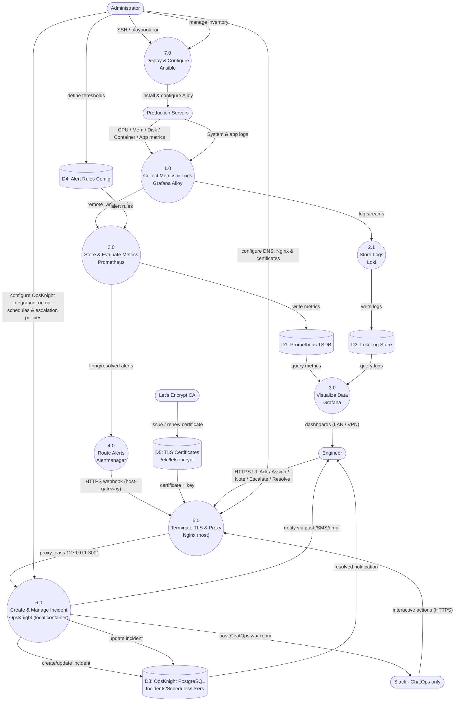
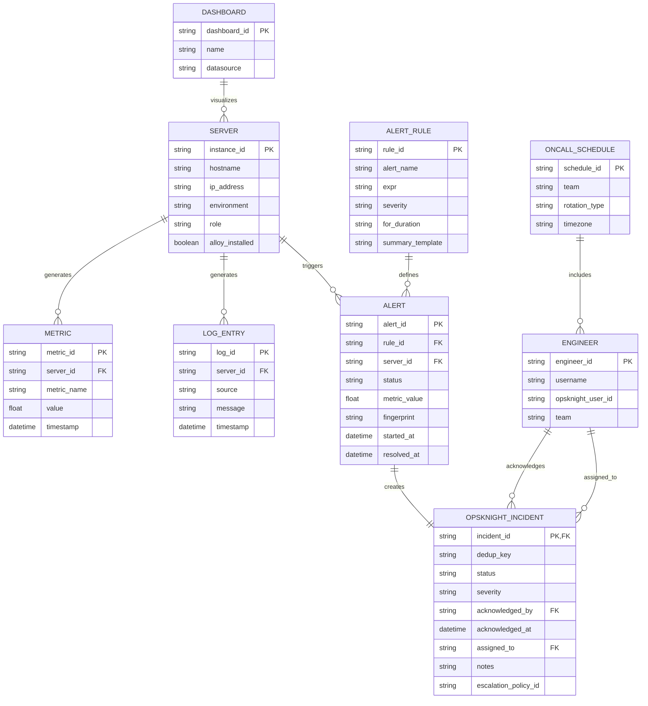
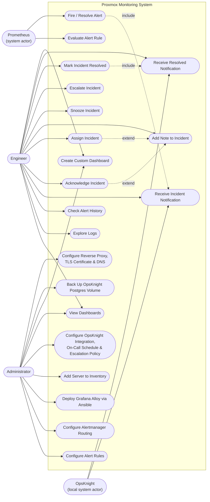

# System Diagrams

Back to the [README](../README.md). All diagrams render natively on GitHub.

## 1. Data Flow Diagram (DFD)

Process 5.0 (reverse proxy) and data store D5 (TLS certificates) are new in v2.2.

## 2. Entity Relationship Diagram (ERD)

## 3. Use Case Diagram

UC21 (reverse proxy, TLS and DNS) is new in v2.2.

